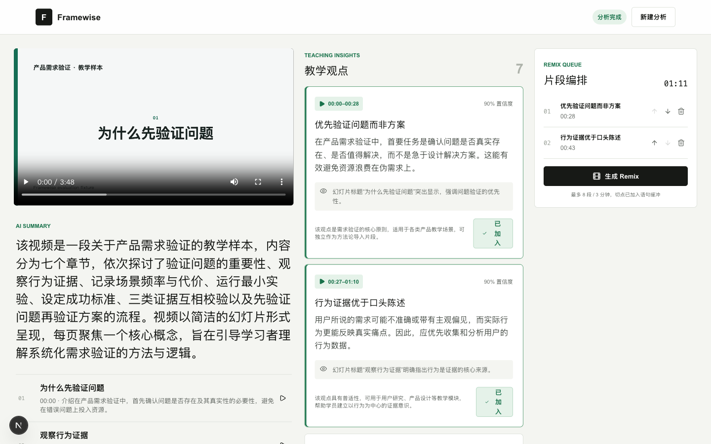
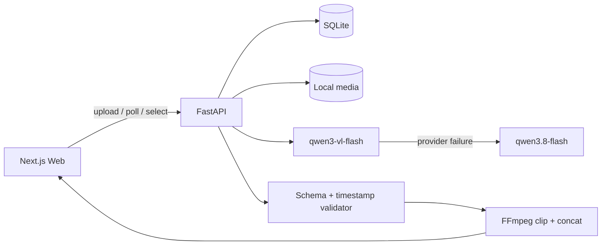

# Framewise

Framewise 是一个 AI 教育视频理解与 Remix Web MVP。上传 3–15 分钟课程视频后，它会提炼摘要、章节和教学观点，并为每条观点保留可跳转的原视频证据。用户选择和排序观点后，系统用 FFmpeg 生成可播放、下载的 MP4。



## 三分钟演示路径

1. 首页上传 MP4、MOV 或 WebM；服务端校验 3–15 分钟和 300 MB 上限。
2. 任务页展示真实阶段：预处理、视频理解、教学洞察、完成或失败。
3. 在工作台点击章节或观点时间，回看原视频证据。
4. 选择最多 8 个观点，通过上下按钮调整顺序，总时长不超过 3 分钟。
5. 生成 Remix，在页面预览并下载 H.264/AAC MP4。

## 架构



- `apps/web`：Next.js 16、React 19、TypeScript、Vitest、Playwright；
- `apps/api`：FastAPI、SQLModel/SQLite、Pydantic、httpx；
- 模型：主通道 `qwen3-vl-flash`，端点异常时回退 `qwen3.8-flash`；
- 长视频：按约 3 分钟分段生成 480p/0.5 FPS 临时代理，逐段理解后合并回原视频时间轴；原视频仍用于证据回放和 Remix；
- 媒体：ffprobe 预检，FFmpeg 使用参数数组裁剪并标准化为 H.264/AAC；
- 持久化：任务 URL 可在刷新后恢复，不依赖浏览器内存。

## 本地启动

要求 Node.js 20+、Python 3.12、uv、FFmpeg 和 ffprobe。

```bash
cp .env.example .env
# 在 .env 中填写至少一组模型连接配置
make install
make dev-api
make dev-web
```

访问 [http://localhost:3000](http://localhost:3000)。API 默认运行在 `http://localhost:8000`。

关键环境变量：

```dotenv
ON_DEMAND_API_KEY=
ON_DEMAND_BASE_URL=
BAILIAN_API_KEY=
BAILIAN_BASE_URL=
VIDEO_UNDERSTANDING_MODEL=qwen3-vl-flash
WORKSPACE_VIDEO_MODEL=qwen3.8-flash
NEXT_PUBLIC_API_BASE_URL=http://localhost:8000
```

真实 `.env` 已被 Git 忽略。应用和日志不输出密钥或 Base URL。

## 验证

```bash
make verify
```

该命令依次运行后端测试、前端组件测试、ESLint、production build 和离线 Playwright 全流程；不会调用真实模型。首次运行 E2E 前执行：

```bash
cd apps/web && npx playwright install chromium
```

当前验证覆盖上传限制、任务状态、严格模型 Schema、时间范围、端点回退、嵌套 usage、安全文件访问、可信 insight ID、FFmpeg 输出、刷新恢复和浏览器主流程。真实评测结果见 [docs/evaluation.md](docs/evaluation.md)。

## 实测成本

三个 3:48–3:59 样本使用 `qwen3.8-flash` 的单次估算成本为 ¥0.117–¥0.123，平均约 ¥0.120。5 次有效评测合计约 ¥0.600。成本由供应商 usage 和配置的参考单价估算，最终以实际账单为准。

## 产品边界

- 支持 MP4、MOV、WebM，3–15 分钟，最大 300 MB；
- 模型生成候选范围，系统增加 1 秒边界缓冲，用户通过原视频预览确认；
- 单个观点必须为 5–120 秒；Remix 最多 8 段、总长不超过 180 秒；
- 当前为本机单进程 MVP，不包含云端部署、账号、支付、团队协作、对象存储或分布式任务队列；
- 不做生成式视频、字幕烧录、多视频混剪或复杂时间线编辑；
- 本地视频会写入 `data/`，不会提交 Git。真实部署需要补充保留期限、删除机制、访问控制和对象存储策略。

## 已知限制与 Roadmap

- Base64 视频请求会增加内存占用，生产环境应改为受控对象存储 URL；
- 模型时间范围不是词级时间戳。只有真实评测中超过三分之一样本明显断句时，才增加本地 Whisper 对齐；
- FastAPI `BackgroundTasks` 只适合单进程演示，部署时应迁移到持久任务队列；
- 下一阶段优先增加片段级预览、用户微调切点、任务清理策略和可观测性，而不是扩展生成式能力。

部署暂不在本次 Homework 范围。
